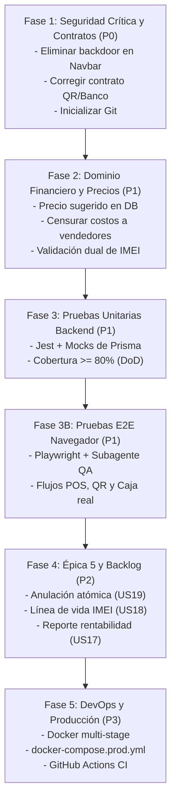

# 📁 Auditoría Técnica y Hojas de Ruta de Remediación — CentralPhone (auditoria1)

Este directorio contiene el informe completo de la **Auditoría Técnica Integral** del proyecto CentralPhone, junto con los **Planes de Ejecución Detallados** organizados por fases cronológicas y de criticidad para corregir los defectos detectados y completar el sistema bajo los estándares de producción.

---

## 📑 Índice de Documentos

### 1. Informe Maestro de Auditoría
* 📄 **[`auditoria_tecnica_integral_centralphone.md`](./auditoria_tecnica_integral_centralphone.md)**
  * Diagnóstico global y matriz de madurez del proyecto.
  * Evaluación de cumplimiento de las Reglas Inmutables ([`GEMINI.md`](../../GEMINI.md)).
  * Catálogo de vulnerabilidades, defectos críticos (backdoor en UI, desajuste de contrato QR) y fortalezas (3FN, transacciones ACID, UI Apple Precision).
  * Estado de avance frente al [Product Backlog](../backlog/PRODUCT_BACKLOG.md).

---

### 2. Planes de Ejecución y Remediación por Fase

| Fase | Documento | Prioridad | Estimación | Alcance Clave |
| :---: | :--- | :---: | :---: | :--- |
| **Fase 1** | 🛡️ **[`plan_fase_1_seguridad_y_contratos.md`](./plan_fase_1_seguridad_y_contratos.md)** | **P0 (Inmediato)** | 8h | Purgar backdoor de roles en Navbar, remover contraseñas en frontend, alinear contrato API/UI del QR oficial, parametrizar seeder y activar Git. |
| **Fase 2** | 💼 **[`plan_fase_2_dominio_financiero_y_precios.md`](./plan_fase_2_dominio_financiero_y_precios.md)** | **P1 (Alta)** | 12h | `precioVentaSugeridoBs` en base de datos, confidencialidad de costos para vendedores, piso mínimo de venta en mostrador y validación dual cruzada de IMEIs. |
| **Fase 3** | 🧪 **[`plan_fase_3_calidad_y_pruebas_unitarias.md`](./plan_fase_3_calidad_y_pruebas_unitarias.md)** | **P1 (Alta)** | 16h | Infraestructura de Jest + Mocks de Prisma, suite de 25+ pruebas unitarias de negocio y alcance del **80% de cobertura (DoD)**. |
| **Fase 3B**| 🎭 **[`plan_fase_3b_pruebas_e2e_playwright.md`](./plan_fase_3b_pruebas_e2e_playwright.md)** | **P1 (Alta)** | 14h | Pruebas E2E en navegador con Playwright y subagente QA: flujos reales de login, cobro QR en POS, caja y recepción; modo headed y headless. |
| **Fase 4** | 📈 **[`plan_fase_4_completitud_backlog_epica_5.md`](./plan_fase_4_completitud_backlog_epica_5.md)** | **P2 (Media)** | 20h | Anulación de ventas con rollback atómico (US19), línea de vida completa por IMEI (US18) y dashboard de rentabilidad neta (US17). |
| **Fase 5** | 🐳 **[`plan_fase_5_devops_docker_produccion_cicd.md`](./plan_fase_5_devops_docker_produccion_cicd.md)** | **P3 (Normal)** | 10h | Dockerfiles multi-stage (imágenes < 180MB, non-root), compose de producción inmutable y pipeline de GitHub Actions (CI). |

---

## 🗺️ Diagrama de Ruta de Implementación

---

## 📌 Guía de Inicio Rápido para Ejecutar las Fases
Para comenzar la ejecución de las mejoras, se recomienda iniciar de forma estricta por la **Fase 1**, ya que resuelve los bloqueantes de seguridad y estabilidad que condicionan el resto de las funcionalidades.
