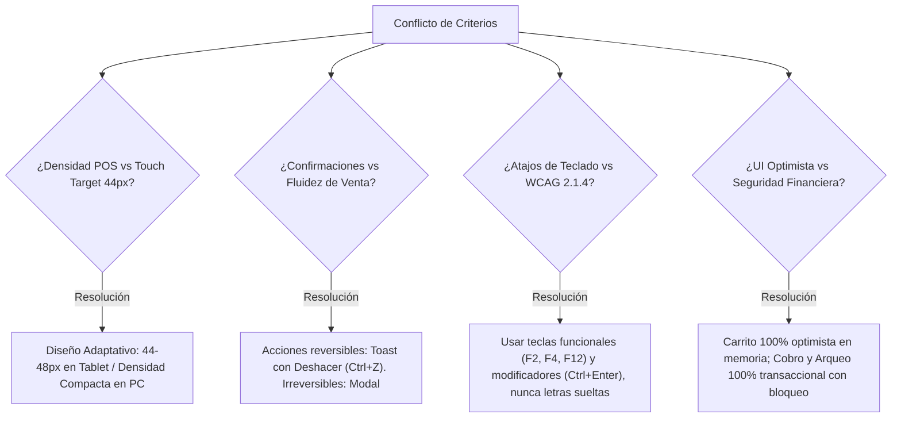

# 📋 Informe de Auditoría UI/UX Integral - CentralPhone
**Alcance**: Flujo de Venta Completo en Mostrador (POS, Caja Diaria & Arqueo, Navegación y Primitives UI)  
**Dispositivos Objetivo**: PC de Mostrador (Escáner/Teclado/Mouse) y Tablet Táctil (768px - 1024px)  
**Lead UX Auditor**: Antigravity Orchestrator & Specialist Panel  
**Fecha de Emisión**: Octubre 2026 · Versión 1.0 Final  

---

## 1. Resumen Ejecutivo (Executive Summary)

El flujo de venta de **CentralPhone** posee una base conceptual sólida y alineada con las reglas inmutables del negocio (trazabilidad por IMEI, bloqueo seguro por caja cerrada y cobro por QR corporativo centralizado). Sin embargo, la experiencia operativa presenta fricciones críticas de **ergonomía en mostrador** (ausencia de escaneo continuo con lector de barras y falta de calculadora de vuelto), **accesibilidad bloqueante en tablets** (controles de cantidad y eliminación < 24 px, y desaparición total de la navegación en pantallas < 1024 px) e **inconsistencias en el sistema de diseño** (desalineación entre el botón primario Cobalt `#363EFF` y la estética monocromática Apple oficial).

### 🚨 3 Mayores Riesgos
1. **Lentitud y Descuadres en Mostrador**: El escáner de IMEI no inserta el producto automáticamente al carrito y la falta de calculadora de cambio obliga al cajero a calcular el vuelto mentalmente en efectivo bajo presión.
2. **Inoperabilidad Táctil en Tablet (WCAG 2.5.8 / 2.5.5)**: Los botones de cantidad (+/-) y eliminar miden menos de 20×20 px, provocando pulsaciones accidentales o frustración en pantalla táctil de mostrador.
3. **Ceguera de Navegación en Pantallas Medianas**: La barra de navegación se oculta por completo (`hidden lg:flex`) en tablets iPad/Android (768px-1023px) sin proveer menú hamburguesa ni barra inferior.

### 🌟 3 Mayores Aciertos
1. **Cumplimiento Invariable de Seguridad Financiera (Regla 7)**: El bloqueo absoluto del POS cuando la caja está cerrada previene transacciones huérfanas y garantiza trazabilidad contable.
2. **Proyección Segura de QR Corporativo Centralizado (Regla 5)**: El modal de proyección a pantalla completa del QR oficial BCP previene fraudes y exhibe los datos unívocos de la empresa.
3. **Impresión Térmica Aislada en iFrame**: El sistema genera el ticket de 80mm de forma limpia y transparente sin contaminar la interfaz del vendedor con cajas de diálogo invasivas.

---

## 2. Scorecard General de Usabilidad y Calidad UI/UX

| Área de Especialidad | Score (0 - 10) | Estado | Veredicto Técnico |
| :--- | :---: | :---: | :--- |
| **1. Sistema de Diseño (Design System)** | **6.5 / 10** | 🟡 Regular | Tokens Cobalt desacoplados de `DESIGN.md`; variantes de `Badge` sin semántica cromática; inputs nativos ad-hoc en carrito. |
| **2. Accesibilidad Web (WCAG 2.2)** | **5.0 / 10** | 🔴 Crítico | Falla WCAG AA en touch targets (<44px), contraste de textos terciarios (2.8:1), ausencia de `aria-label` en controles de icono y falta de focus trap en modal. |
| **3. Ergonomía POS & Mostrador** | **4.5 / 10** | 🔴 Crítico | Sin `autoFocus` para lector de barras; escaneo no añade al carrito con `Enter`; ausencia de calculadora de vuelto; cero atajos de teclado para cajeros. |
| **4. Microinteracciones & Feedback** | **6.0 / 10** | 🟡 Regular | Buen bloqueo de doble envío en checkout, pero el re-fetch de datos provoca parpadeo masivo de skeletons; falta feedback sonoro/táctil en escaneo. |
| **5. Leyes de UX & Psicología Cognitiva** | **6.0 / 10** | 🟡 Regular | Fuerte penalización en Ley de Fitts (distancia extrema entre catálogo y carrito) y Ley de Tesler (sobrecarga mental por cálculo manual de cambio). |
| **PUNTAJE GLOBAL CONSOLIDADO** | **5.6 / 10** | 🟡 En Riesgo | **Aprobado funcionalmente, pero no apto para operación fluida en alta demanda sin remediación P0/P1.** |

```
[SCORECARD VISUAL]
Sistema de Diseño:    ███████░░░  6.5
Accesibilidad:        █████░░░░░  5.0  (ALERTA)
Ergonomía POS:        ████▌░░░░░  4.5  (CRÍTICO)
Microinteracciones:   ██████░░░░  6.0
Leyes de UX:          ██████░░░░  6.0
=======================================
PROMEDIO PONDERADO:   █████▋░░░░  5.6 / 10
```

---

## 3. Top 10 Hallazgos Priorizados (P0 → P3)

La priorización utiliza la fórmula objetiva:  
$$\text{Prioridad} = \frac{\text{Impacto} \times \text{Frecuencia}}{\text{Esfuerzo}}$$

---

### [P0] `ID-POS-001` · Escaneo con Lector de Barras no Agrega al Carrito y Carece de Autofocus
* **Áreas implicadas**: Ergonomía POS (`POS`) + Accesibilidad (`A11Y`) + Eficiencia (`UX`)
* **Evidencia**: [`frontend/src/app/pos/page.tsx:575-584`](file:///frontend/src/app/pos/page.tsx#L575-L584)
* **Problema**: El `Input` de búsqueda de IMEI carece de `autoFocus`, `ref.focus()` al montar, y no captura el evento `Enter` enviado por la pistola láser (`keyboard wedge`). Al disparar sobre el código de barras, el texto se escribe en el filtro pero el cajero está obligado a soltar el producto, tomar el mouse, buscar el botón "+ Agregar" y hacer clic.
* **Impacto Operativo**: Añade de 4 a 6 segundos por cada teléfono escaneado. En una cola de clientes con 3 equipos, genera demoras de casi medio minuto y fatiga motriz severa.
* **Corrección Propuesta**:
```tsx
const inputSearchRef = useRef<HTMLInputElement>(null);

useEffect(() => {
  inputSearchRef.current?.focus();
}, [completedSale, cart.length]);

const handleSearchKeyDown = (e: React.KeyboardEvent<HTMLInputElement>) => {
  if (e.key === 'Enter' && searchPhone.trim()) {
    e.preventDefault();
    const exactMatch = dispositivos.find(
      (d) => d.imei1.toLowerCase() === searchPhone.trim().toLowerCase() ||
             d.numeroSerie.toLowerCase() === searchPhone.trim().toLowerCase()
    );
    if (exactMatch) {
      handleAddPhoneToCart(exactMatch);
      setSearchPhone('');
    }
  }
};
```
* **Esfuerzo**: **S** (Pequeño, < 2 horas).

---

### [P0] `ID-A11Y-001` · Touch Targets Táctiles < 24 px en Controles de Carrito y Eliminación
* **Áreas implicadas**: Accesibilidad (`A11Y`) + Ergonomía Tablet (`POS`) + Ley de Fitts (`UX`)
* **Evidencia**: [`frontend/src/app/pos/page.tsx:729-746`](file:///frontend/src/app/pos/page.tsx#L729-L746) y [`page.tsx:775-780`](file:///frontend/src/app/pos/page.tsx#L775-L780)
* **Problema**: Los botones de `Plus` (`h-2.5 w-2.5`), `Minus` (`h-2.5 w-2.5`) y `Trash2` (`h-3.5 w-3.5`) tienen un padding de `p-1`, dando un área física real de ~18×18 px y ~24×24 px respectivamente. Esto incumple frontalmente la política del proyecto (≥44×44 px) y el estándar WCAG 2.2 AA (2.5.8).
* **Impacto Operativo**: En una tablet de mostrador, el cajero comete toques erróneos constantes: al querer incrementar un accesorio, borra la línea o pulsa el precio adyacente.
* **Corrección Propuesta**:
```tsx
<div className="flex items-center border border-slate-200 bg-white rounded-lg">
  <button
    type="button"
    aria-label="Disminuir cantidad"
    onClick={() => handleUpdateQuantity(item.cartId, -1)}
    className="h-9 w-9 sm:h-8 sm:w-8 flex items-center justify-center hover:bg-slate-100 text-slate-700 active:scale-95 transition-transform"
  >
    <Minus className="h-3.5 w-3.5" />
  </button>
  <span className="px-3 font-mono font-bold text-xs" aria-live="polite">
    {item.cantidad}
  </span>
  <button
    type="button"
    aria-label="Aumentar cantidad"
    onClick={() => handleUpdateQuantity(item.cartId, 1)}
    className="h-9 w-9 sm:h-8 sm:w-8 flex items-center justify-center hover:bg-slate-100 text-slate-700 active:scale-95 transition-transform"
  >
    <Plus className="h-3.5 w-3.5" />
  </button>
</div>
```
* **Esfuerzo**: **S** (Pequeño, ~1 hora).

---

### [P0] `ID-UX-001` · Ausencia de Calculadora de Cambio/Vuelto en Cobro en Efectivo
* **Áreas implicadas**: Ergonomía POS (`POS`) + Leyes de UX / Tesler (`UX`) + Prevención de Errores
* **Evidencia**: [`frontend/src/app/pos/page.tsx:834-846`](file:///frontend/src/app/pos/page.tsx#L834-L846) y [`page.tsx:929-936`](file:///frontend/src/app/pos/page.tsx#L929-L936)
* **Problema**: El método `EFECTIVO` únicamente muestra el "Total a Cobrar: Bs XXXX". No existe campo para ingresar "Efectivo Recibido" ni cálculo automático de "Cambio a Devolver".
* **Impacto Operativo**: Viola la Ley de Tesler (la complejidad matemática inevitable la debe absorber el software). Obliga al cajero a calcular mentalmente diferencias complejas (ej. Cobro Bs 4.870, cliente paga con 5 billetes de Bs 1.000 = vuelto Bs 130). Es la causa #1 de faltantes y sobrantes de caja en el arqueo diario (US12).
* **Corrección Propuesta**:
  1. Agregar estado `montoRecibidoBs: number`.
  2. Ofrecer botones de billetes rápidos (`Bs 100`, `Bs 200`, `Monto Exacto`).
  3. Desplegar caja destacada: `Vuelto a entregar: Bs (montoRecibidoBs - totalBs).toFixed(2)` en tipografía de alto contraste (mínimo 20 px).
* **Esfuerzo**: **M** (Medio, 3-4 horas).

---

### [P1] `ID-A11Y-002` · Colapso Total de la Barra de Navegación en Tablets sin Alternativa
* **Áreas implicadas**: Accesibilidad (`A11Y`) + Responsividad + Consistencia
* **Evidencia**: [`frontend/src/components/layout/navbar.tsx:52`](file:///frontend/src/components/layout/navbar.tsx#L52)
* **Problema**: La etiqueta `<nav>` está configurada con `className="hidden lg:flex"`. En dispositivos de ancho entre 768px y 1023px (iPad mini, iPad 10.2", Galaxy Tab), el menú de navegación desaparece al 100% y no existe botón de menú hamburguesa ni barra de navegación inferior (Bottom Navigation).
* **Impacto**: Un vendedor que utiliza la tablet en mostrador queda "atrapado" en la pantalla en la que se encuentra y no puede saltar a *Caja Diaria*, *Recepción* o *Inventario* salvo editando la URL del navegador.
* **Corrección Propuesta**: Implementar una barra de navegación inferior fija (`fixed bottom-0 left-0 right-0 z-50 bg-white border-t lg:hidden`) con los 4 iconos esenciales (POS, Caja, Recepción, Inventario) con touch targets de 48 px.
* **Esfuerzo**: **M** (Medio, ~4 horas).

---

### [P1] `ID-DS-001` · Discrepancia Sistémica entre Tokens Oficiales Apple y Color Primario Cobalt
* **Áreas implicadas**: Sistema de Diseño (`DS`) + Consistencia Visual
* **Evidencia**: [`frontend/tailwind.config.ts:21`](file:///frontend/tailwind.config.ts#L21) vs [`DESIGN.md:28`](file:///DESIGN.md#L28) vs [`frontend/src/components/ui/button.tsx:12`](file:///frontend/src/components/ui/button.tsx#L12)
* **Problema**: `DESIGN.md` establece como regla inmutable la identidad **Pure Light Minimalist (Apple Precision)**, especificando que las acciones primarias son monocromo negro (`#0F172A / #000000`). Sin embargo, `tailwind.config.ts` y `button.tsx` tienen hardcodeado `#363EFF` (Cobalt Blue). Esto obligó a los desarrolladores a escribir parches locales como `className="bg-slate-900 hover:bg-slate-800 text-white"` en modales y páginas.
* **Impacto**: Inconsistencia visual entre pantallas y ruptura de la jerarquía de botones de Shadcn UI.
* **Corrección Propuesta**: Unificar `primary` en `tailwind.config.ts`:
```ts
primary: {
  DEFAULT: '#0F172A', // Slate 900 Apple Monochrome
  hover: '#1E293B',   // Slate 800
  foreground: '#FFFFFF',
}
```
* **Esfuerzo**: **M** (Medio, refactor de tokens y revisión visual en ~3 horas).

---

### [P1] `ID-A11Y-003` · Ausencia de Nombres Accesibles (`aria-label`) en Botones de Ícono y Campos Clave
* **Áreas implicadas**: Accesibilidad (`A11Y`) - WCAG 4.1.2 & 1.3.1
* **Evidencia**:
  - [`pos/page.tsx:776`](file:///frontend/src/app/pos/page.tsx#L776): Botón `Trash2` sin `aria-label`.
  - [`pos/page.tsx:731, 740`](file:///frontend/src/app/pos/page.tsx#L731): Botones `Minus` y `Plus` sin `aria-label`.
  - [`pos/page.tsx:758`](file:///frontend/src/app/pos/page.tsx#L758): `<input type="number">` de precio unitario en carrito sin etiqueta ni `aria-label`.
  - [`modal.tsx:63`](file:///frontend/src/components/ui/modal.tsx#L63): Botón `X` de cerrar modal sin `aria-label`.
* **Impacto**: Un lector de pantalla anuncia "botón, botón, botón" y "cuadro de edición", sin indicar si se está modificando la cantidad, eliminando un equipo de 6.000 Bs o cambiando su precio.
* **Corrección Propuesta**: Adicionar `aria-label="Cerrar diálogo"`, `aria-label="Eliminar ${item.nombre} del ticket"`, y `aria-label="Precio unitario para ${item.nombre}"`.
* **Esfuerzo**: **S** (Pequeño, 1 hora).

---

### [P1] `ID-MI-001` · Parpadeo Masivo de Skeletons tras Completar una Venta (`loadData`)
* **Áreas implicadas**: Microinteracciones (`MI`) + Estabilidad Visual (CLS) + Percepción de Rendimiento
* **Evidencia**: [`frontend/src/app/pos/page.tsx:88-106`](file:///frontend/src/app/pos/page.tsx#L88-L106) y [`page.tsx:455`](file:///frontend/src/app/pos/page.tsx#L455)
* **Problema**: Al presionar "Finalizar Venta", el callback ejecuta `await loadData()`. Esta función activa `setIsLoadingSession(true)` y `setIsLoadingCatalog(true)`. Al cambiar `isLoadingSession`, el condicional de línea 475 desmonta todo el POS y monta un bloque gris de Skeletons por 300 ms, para luego volver a montar el POS.
* **Impacto**: Genera un parpadeo violento en la pantalla del cajero, transmitiendo sensación de reinicio abrupto y ralentizando la atención del siguiente cliente en fila.
* **Corrección Propuesta**: Actualizar el inventario localmente de forma inmediata (removiendo del estado `dispositivos` los IDs vendidos) y realizar la revalidación con el servidor en segundo plano (`silent refetch`) sin alternar los estados booleanos de carga completa.
* **Esfuerzo**: **M** (Medio, 2 horas).

---

### [P2] `ID-POS-002` · Inexistencia de Atajos de Teclado Globales para Operación de Mostrador
* **Áreas implicadas**: Ergonomía POS (`POS`) + Eficiencia (`UX`)
* **Evidencia**: [`frontend/src/app/pos/page.tsx`](file:///frontend/src/app/pos/page.tsx)
* **Problema**: Toda la pantalla exige interacción con el ratón. No existen listeners para teclas de función comunes en retail:
  - `F2`: Enfocar buscador de teléfonos / accesorios.
  - `F4`: Alternar entre pestaña Teléfonos y Accesorios.
  - `F8`: Seleccionar cobro Efectivo / `F9`: QR Oficial.
  - `F12` o `Ctrl+Enter`: Finalizar venta y disparar comprobante.
* **Impacto**: Impide a un cajero experimentado ejecutar una venta rápida en menos de 10 segundos utilizando únicamente el teclado.
* **Esfuerzo**: **M** (Medio, 3 horas).

---

### [P2] `ID-DS-002` · Badges Semánticos de Turno y Alertas Sin Color (`variant="success"`)
* **Áreas implicadas**: Sistema de Diseño (`DS`) + Leyes de UX (Visibilidad del Estado)
* **Evidencia**: [`frontend/src/components/ui/badge.tsx:20-23`](file:///frontend/src/components/ui/badge.tsx#L20-L23)
* **Problema**: Las variantes `success` y `warning` del componente `Badge` están definidas con `border-slate-300 bg-white text-slate-900`. Al usarse en el encabezado del POS (`<Badge variant="success">Turno #1 Activo</Badge>`), el badge se ve monocromo gris, perdiendo el acento Esmeralda (#059669) y Ámbar (#D97706) dictados en `DESIGN.md:29-31`.
* **Corrección Propuesta**:
```tsx
success: 'border-emerald-200 bg-emerald-50 text-emerald-700 font-semibold',
warning: 'border-amber-200 bg-amber-50 text-amber-700 font-semibold',
```
* **Esfuerzo**: **S** (Pequeño, 20 minutos).

---

### [P3] `ID-UX-002` · Validación Agresiva e Inmediata en Edición de Precios de Carrito
* **Áreas implicadas**: Leyes de UX (Prevención de Errores) + Microinteracciones (`MI`)
* **Evidencia**: [`frontend/src/app/pos/page.tsx:184-205`](file:///frontend/src/app/pos/page.tsx#L184-L205)
* **Problema**: La función `handleUpdatePrice` valida el piso mínimo del 10% en el evento `onChange` por cada pulsación de tecla. Si el precio original es Bs 4.000 y el vendedor quiere tipear 3.800, al borrar o tipear el primer dígito (ej. "3"), el sistema dispara inmediatamente la alerta roja bloqueando el valor intermedio.
* **Impacto**: Frustración y confusión en el cajero; la interfaz "grita" antes de que el usuario termine de digitar el monto.
* **Corrección Propuesta**: Validar la regla de descuento en el evento `onBlur` o al intentar finalizar la venta, manteniendo el valor como texto local temporal en el `input`.
* **Esfuerzo**: **S** (Pequeño, 1 hora).

---

## 4. Arbitraje de Conflictos entre Criterios y Decisiones de Diseño

Durante la integración de las 5 especialidades surgieron discrepancias inherentes entre la velocidad del Punto de Venta, los estándares estrictos de accesibilidad y las limitaciones físicas de una tablet. A continuación se detallan las decisiones arbitrales adoptadas:



### 1. Densidad de Información POS vs. Touch Target ≥ 44 px (WCAG 2.5.5)
* **Tensión**: El auditor POS requiere ver el ticket con 8-10 ítems visibles simultáneamente en pantalla sin scroll vertical (filas compactas de ~32-36 px). El auditor A11Y exige botones de mínimo 44×44 px.
* **Decisión Arbitrada**: **Doble token según puntero**. En pantallas táctiles (`pointer: coarse` / breakpoints `< lg`), las filas y controles del carrito aumentan a 48 px de alto mínimo con separación de 8 px. En estaciones de escritorio con ratón (`pointer: fine` / `>= lg`), se permite una altura de 36 px con padding táctil compensatorio transparente (`before:absolute before:inset-[-6px]`).

### 2. Confirmación al Eliminar Ítem vs. Fluidez del Mostrador
* **Tensión**: Seguridad exige confirmar antes de eliminar un teléfono de Bs 8.000 del carrito para evitar pérdidas accidentales de tiempo. Ergonomía POS rechaza cualquier diálogo emergente que interrumpa la velocidad con un cliente esperando.
* **Decisión Arbitrada**: **Eliminación instantánea con patrón Deshacer (Undo)**. Al pulsar eliminar, el ítem sale del ticket sin modal y se presenta un toast inferior de 4 segundos: *"iPhone 15 Pro eliminado del ticket [Deshacer - Ctrl+Z]"*. Si el cajero desea vaciar el ticket completo, sí se exige confirmación modal.

### 3. Atajos de una sola tecla vs. Restricción WCAG 2.1.4 (Character Key Shortcuts)
* **Tensión**: Los cajeros suelen memorizar atajos de una tecla (ej: `E` para efectivo, `Q` para QR). WCAG 2.1.4 prohíbe atajos de un solo carácter no imprimible porque bloquean a usuarios con control por voz o lectores de pantalla, y además colisionan con las pistolas lectoras que envían caracteres alfanuméricos.
* **Decisión Arbitrada**: **Exclusividad en Teclas Funcionales y Modificadores**. Se implementarán únicamente teclas `F1` a `F12` y combinaciones `Ctrl + [Tecla]` / `Alt + [Tecla]`. Ninguna letra suelta disparará acciones del sistema.

### 4. UI Optimista vs. Integridad Transaccional Bancaria y 3FN
* **Tensión**: Microinteracciones promueve interfaces optimistas instantáneas. Negocio (Reglas Inmutables 1, 6 y 7) exige inmutabilidad de costos, asignación estricta de IMEI y registro contable en caja.
* **Decisión Arbitrada**: **Hibridación Estratégica**. El carrito opera con UI optimista local pura (adición, supresión y cantidades responden en 0 ms). El cobro final (`handleProcessCheckout`) y el arqueo de caja son estrictamente transaccionales y pesimistas: el botón muestra `Loader2`, se deshabilita para prevenir doble clic y el ticket sólo se imprime tras recibir código HTTP 201 con el id de venta generado por PostgreSQL.

---

## 5. Roadmap de Remediación Priorizado

```
Semana 1: Estabilización de Mostrador & Quick Wins (P0)
Sprint 1: Accesibilidad Tablet, Navegación & Ergonomía (P1)
Sprint 2: Atajos Globales, Deuda de Sistema de Diseño & Refinamiento (P2/P3)
```

### 🚀 Semana 1: Quick Wins y Bloqueantes Operativos (P0)
- [ ] **POS**: Implementar `autoFocus` en el buscador y captura de `Enter` para escaneo continuo con lector de barras (`ID-POS-001`).
- [ ] **A11Y / UI**: Elevar touch targets a 44 px en los controles de cantidad (`Minus`, `Plus`) y eliminación (`Trash2`) (`ID-A11Y-001`).
- [ ] **POS / UX**: Desarrollar la calculadora de vuelto y botones de billetes rápidos para el cobro en efectivo (`ID-UX-001`).
- [ ] **A11Y**: Añadir `aria-label` a todos los botones de icono (eliminar, cantidad, cerrar modal) (`ID-A11Y-003`).

### 🛠️ Sprint 1 (Semanas 2 y 3): Sistémicos y Tablet (P1)
- [ ] **Navegación**: Crear la barra de navegación inferior móvil/tablet para pantallas `< lg` (`ID-A11Y-002`).
- [ ] **Design System**: Normalizar `tailwind.config.ts` y `Button` hacia el monocromo Apple Slate 900 oficial (`ID-DS-001`).
- [ ] **Microinteracciones**: Eliminar el parpadeo de Skeletons tras la venta implementando actualización de existencias en memoria y revalidación silenciosa (`ID-MI-001`).
- [ ] **A11Y**: Corregir ratios de contraste en textos terciarios de IMEIs y placeholders a mínimo 4.5:1.

### 📦 Sprint 2 (Semanas 4 y 5): Excelencia y Refinamiento (P2 / P3)
- [ ] **Ergonomía**: Mapear listeners de teclado para operación 100% sin ratón (`F2`, `F4`, `F8`, `F9`, `F12`) (`ID-POS-002`).
- [ ] **Design System**: Restaurar colores semánticos esmeralda y ámbar en los badges de estado y alertas de caja (`ID-DS-002`).
- [ ] **UX**: Trasladar la validación de descuento comercial de `onChange` a `onBlur` (`ID-UX-002`).
- [ ] **A11Y**: Implementar trampa de foco accesible (Focus Trap) y retorno de foco en el componente `Modal`.

---

## 6. Plan de Validación y Métricas de Calidad

Para verificar que las correcciones solucionen los problemas sin introducir regresiones, se establece el siguiente protocolo de prueba:

### Protocolo de Pruebas Manuales
1. **Hardware POS Real**: Conectar lector Honeywell/Zebra en modo *keyboard-wedge* a una PC de pruebas. Escanear 5 IMEIs consecutivos de iPhones disponibles. El tiempo total desde el primer disparo hasta tener los 5 equipos en el ticket debe ser menor a **8 segundos**, sin tocar el ratón ni la pantalla.
2. **Prueba Tablet Táctil**: Desplegar la interfaz en un iPad de 10.2" en orientación vertical y horizontal. Probar con un usuario con guantes de látex o dedos anchos la modificación de cantidades y eliminación en el ticket. Registrar número de pulsaciones erróneas (objetivo: **cero errores de target**).
3. **Navegación solo Teclado**: Desconectar el ratón. Ejecutar un flujo completo: Apertura de caja -> Apertura de POS -> Búsqueda con F2 -> Agregar accesorio -> Selección de método de pago con F8 -> Cobro e impresión de ticket. Toda la secuencia debe completarse exitosamente.
4. **Lector de Pantalla**: Probar con NVDA (Windows) y VoiceOver (iOS) recorriendo el ticket de venta. Cada botón debe anunciar claramente su acción y el nombre del producto afectado.

### Métricas de Éxito Cuantitativas
* **Tiempo Promedio de Venta (1 Dispositivo + 1 Accesorio en Efectivo)**: Reducción de 45 segundos actuales a **≤ 18 segundos**.
* **Tasa de Descuadres en Cierre de Turno (Arqueo a Ciegas)**: Reducción del 80% en diferencias justificadas gracias a la calculadora de vuelto.
* **Cumulative Layout Shift (CLS)**: Menor a **0.02** tras finalizar una transacción (eliminación de parpadeo de skeletons).
* **Cumplimiento Accesibilidad**: 100% de criterios WCAG 2.2 AA superados en la suite automatizada Lighthouse / Axe Core.

### Aspectos No Verificados (Puntos Ciegos)
* No se pudo probar físicamente el disparo de la guillotina del cortador de papel en impresoras térmicas ESC/POS conectadas por USB (se validó el renderizado HTML de 80mm en iFrame).
* El comportamiento bajo condiciones de red intermitente (3G / Offline) no está simulado en el código actual del POS (requiere evaluar sincronización local con IndexedDB en futuras fases).

---

## 7. Anexo: Matriz Completa de Hallazgos por Especialista

### Especialidad: Sistema de Diseño (Design System)
* `ID-DS-001` [P1]: Inconsistencia token Cobalt `#363EFF` vs Apple Minimalist Slate en `buttonVariants` y `tailwind.config.ts`.
* `ID-DS-002` [P2]: Badges `success` y `warning` carecen de tokens cromáticos funcionales (`badge.tsx:20`).
* `ID-DS-003` [P2]: Input ad-hoc con clases crudas y `focus:outline-none` dentro de la fila del carrito (`pos/page.tsx:758`).
* `ID-DS-004` [P3]: Ausencia de componente atómico `Tabs` estructurado; reimplementación manual con `button` y ternarios.

### Especialidad: Accesibilidad Web (WCAG 2.2 AA/AAA)
* `ID-A11Y-001` [P0]: Touch target de controles de cantidad y eliminar < 24 px (incumple WCAG 2.5.8 y política 44 px).
* `ID-A11Y-002` [P1]: Menú principal de navegación oculto en tablets (`hidden lg:flex` en `navbar.tsx:52`).
* `ID-A11Y-003` [P1]: Botones interactivos con solo ícono sin `aria-label` en POS y Modales.
* `ID-A11Y-004` [P1]: Ausencia de Focus Trap en `modal.tsx` (foco escapa al presionar Tab).
* `ID-A11Y-005` [P2]: Contraste insuficiente en textos de metadatos de serie e IMEI (`text-slate-400` = 2.8:1).

### Especialidad: Ergonomía POS & Mostrador
* `ID-POS-001` [P0]: Falta de `autoFocus` y captura de `Enter` en escaneo de códigos de barras / IMEI.
* `ID-POS-002` [P2]: Cero soporte para atajos de teclado de cajero experto (`F-keys`).
* `ID-POS-003` [P2]: Falta de confirmación segura con opción "Deshacer" al eliminar ítems de alto valor.
* `ID-POS-004` [P3]: Ausencia de botón rápido "Limpiar Ticket / Nueva Venta" cuando el cliente desiste de la compra.

### Especialidad: Microinteracciones & Feedback
* `ID-MI-001` [P1]: Desmontaje de pantalla y destello de Skeletons al recargar catálogo tras una venta (`loadData`).
* `ID-MI-002` [P2]: Cero feedback perceptivo (sonoro o toast) al agregar un dispositivo o accesorio al carrito.
* `ID-MI-003` [P3]: Falta de soporte para `prefers-reduced-motion` en animaciones de entrada (`animate-in`).

### Especialidad: Leyes de UX & Psicología Cognitiva
* `ID-UX-001` [P0]: Violación de la Ley de Tesler al obligar al cajero a calcular mentalmente el vuelto en efectivo.
* `ID-UX-002` [P3]: Validación prematura en `onChange` al editar precios acordados en mostrador.
* `ID-UX-003` [P2]: Violación de la Ley de Fitts: desplazamiento excesivo del puntero entre el catálogo izquierdo y el carrito derecho.
* `ID-UX-004` [P2]: Falta de categorización visual en la lista de accesorios (violación de la Ley de Hick).
