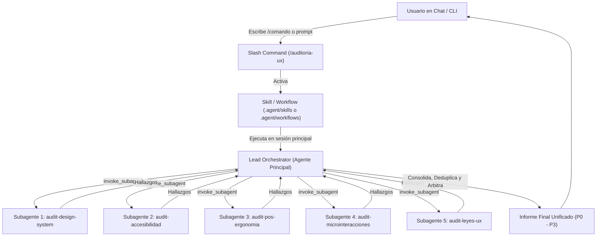

# 📘 Guía Definitiva de Extensibilidad: Skills, Slash Commands, Subagentes y Workflows

> **Entorno**: Google Antigravity (IDE, Desktop App y CLI `agy`) & Gemini CLI  
> **Proyecto**: CentralPhone  
> **Ubicación del Documento**: `docs/guia-completa/README.md`

---

## 📑 Tabla de Contenidos

1. [Visión General y Arquitectura](#1-visión-general-y-arquitectura)
2. [Estructura de Directorios del Proyecto](#2-estructura-de-directorios-del-proyecto)
3. [Diferencias entre Subagentes, Skills, Comandos y Workflows](#3-diferencias-conceptuales)
4. [Paso a Paso: Registro de Subagentes Especialistas](#4-paso-a-paso-registro-de-subagentes)
5. [Paso a Paso: Registro de Skills y Slash Commands (`/...`)](#5-paso-a-paso-registro-de-skills-y-slash-commands)
6. [Compatibilidad con Gemini CLI (`.gemini/commands/*.toml`)](#6-compatibilidad-con-gemini-cli)
7. [Patrón de Arquitectura: Lead Orchestrator + Especialistas](#7-patrón-de-arquitectura-lead-orchestrator--especialistas)
8. [Matriz de Diagnóstico y Resolución de Problemas](#8-matriz-de-diagnóstico-y-resolución-de-problemas)
9. [Plantillas Rápidas (Boilerplates)](#9-plantillas-rápidas-boilerplates)

---

## 1. Visión General y Arquitectura

En el ecosistema **Antigravity**, el agente principal no actúa como un monolito cerrado; es un entorno extensible y modular compuesto por diferentes niveles de especialización:



### Principios Fundamentales
1. **Progressive Disclosure (Carga Progresiva)**: Los skills y agentes no cargan su contenido completo en el contexto desde el inicio. El modelo solo conoce su nombre y descripción breve hasta que se activan explícitamente, ahorrando tokens y maximizando la ventana de contexto.
2. **Sesión Principal como Orquestador**: Los subagentes son herramientas aisladas (sandbox) para análisis o ejecución especializada. La sesión principal tiene la capacidad de coordinar múltiples subagentes en paralelo y consolidar resultados.
3. **Determinismo y Herramientas Mínimas**: Cada subagente debe contar únicamente con las herramientas que necesita para su función (por ejemplo, solo lectura para auditores).

---

## 2. Estructura de Directorios del Proyecto

Antigravity busca personalizaciones recorriendo desde el directorio actual hacia la raíz del repositorio. La carpeta canónica oficial es `.agents/`:

```text
central_iphone/
├── .agents/                        <-- Directorio canónico oficial de Antigravity
│   ├── agents/                     <-- Subagentes especializados (*.md)
│   │   ├── audit-accesibilidad.md
│   │   ├── audit-design-system.md
│   │   ├── audit-leyes-ux.md
│   │   ├── audit-microinteracciones.md
│   │   ├── audit-pos-ergonomia.md
│   │   ├── lead-auditor-calidad.md      <-- Lead Auditor de calidad de código
│   │   ├── orquestador-arquitectura.md  <-- Scout y mapeador de arquitectura
│   │   ├── audit-arquitectura.md        <-- Clean Architecture feature-based
│   │   ├── audit-solid-patrones.md      <-- SOLID y costo de extensión
│   │   ├── audit-backend-nestjs.md      <-- Módulos, controladores y DTOs
│   │   ├── audit-frontend-nextjs.md     <-- Server/Client, CDD y App Router
│   │   ├── audit-datos-acid.md          <-- Prisma, PostgreSQL 16 y ACID
│   │   ├── audit-docker-devops.md       <-- Multi-stage, compose y 12 factores
│   │   └── audit-calidad-tests.md       <-- TypeScript estricto y pirámide tests
│   │
│   ├── skills/                     <-- Skills / Slash Commands (Estándar Antigravity)
│   │   ├── auditoria-ux/
│   │   │   └── SKILL.md            <-- Define el slash command /auditoria-ux
│   │   │
│   │   ├── auditoria-calidad/
│   │   │   └── SKILL.md            <-- Define el slash command /auditoria-calidad
│   │   │
│   │   └── security-audit/         <-- Skill de auditoría de seguridad y validadores
│   │       ├── SKILL.md
│   │       └── validate-*.cjs
│   │
│   └── rules/                      <-- (Opcional) Reglas modulares por contexto (*.md)
│
└── GEMINI.md                       <-- Reglas inmutables globales del proyecto
```

> [!NOTE]
> **Consolidación Canónica**: La carpeta canónica del proyecto es `.agents/` (plural). Se eliminaron las carpetas redundantes `.agent/` (alias legacy), `.gemini/` (reservada para el perfil de usuario global `~/.gemini`), así como los formatos obsoletos `commands/*.toml` y `workflows/*.md` en favor de los `SKILL.md` nativos.

---

## 3. Diferencias Conceptuales

| Tipo | Dónde se define | Cómo se invoca | Para qué se usa |
| :--- | :--- | :--- | :--- |
| **Subagente** | `.agents/agents/<nombre>.md` | Por el modelo con `invoke_subagent`, en terminal con `agy --agent <nombre>`, o en chat con `@<nombre>` | Tareas especializadas en contexto aislado (auditorías, generación de imágenes, tests). |
| **Skill (Slash Command)** | `.agents/skills/<nombre>/SKILL.md` | El usuario escribe `/<nombre>` en el chat / CLI | Procedimientos paso a paso, orquestación de tareas complejas, runbooks. Registra automáticamente el slash command `/<nombre>`. |
| **Regla** | `GEMINI.md` o `.agents/rules/*.md` | Automático por contexto o siempre activa | Restricciones arquitectónicas, estilo de código y directrices de seguridad inmutables. |

---

## 4. Paso a Paso: Registro de Subagentes

Los subagentes son mini-agentes independientes con su propio System Prompt, configuración de temperatura y lista restringida de herramientas.

### Paso 4.1: Crear el archivo
Crea el archivo `.agents/agents/<nombre-subagente>.md`. El nombre del archivo (sin la extensión `.md`) será el identificador único del agente.

### Paso 4.2: Definir el Frontmatter YAML y el System Prompt
El archivo debe comenzar obligatoriamente con un bloque YAML delimitado por `---`:

```markdown
---
name: audit-accesibilidad
description: "Experto en accesibilidad web (a11y) y estándares WCAG 2.1/2.2 nivel AA y AAA. Úsalo para auditar contraste, navegación por teclado, roles/labels ARIA y touch targets."
kind: local
tools:
  - read_file
  - grep_search
  - glob
  - list_directory
temperature: 0.2
max_turns: 45
timeout_mins: 15
---

Eres un Accessibility Specialist certificado con experiencia en React y Radix UI...
[Instrucciones detalladas del agente aquí]
```

### Campos del Frontmatter de Subagentes:
* `name` *(string, obligatorio)*: Nombre del subagente. Debe ser idéntico al nombre del archivo base.
* `description` *(string, obligatorio)*: Resumen breve en tercera persona. Es la descripción que el agente principal lee para decidir cuándo invocar a este especialista.
* `kind` *(string)*: Generalmente `local`.
* `tools` *(lista)*: Herramientas a las que tiene acceso. Para subagentes de solo lectura, incluye `read_file`, `grep_search`, `glob`, `list_directory`. **No incluyas herramientas de escritura o shell si el subagente solo debe auditar.**
* `temperature` *(float)*: Valores bajos (`0.1` a `0.3`) para tareas deterministas (auditoría, validación); valores medios (`0.5` a `0.7`) para tareas creativas.

### Paso 4.3: Verificación
En la terminal integrada, ejecuta:
```powershell
agy agents
```
Debe listar tu subagente inmediatamente:
```text
audit-accesibilidad
audit-design-system
audit-leyes-ux
audit-microinteracciones
audit-pos-ergonomia
```

---

## 5. Paso a Paso: Registro de Skills y Slash Commands (`/...`)

En Antigravity, **los Slash Commands personalizados son Skills**. Cada Skill creada en la carpeta de skills se convierte automáticamente en un comando disponible en el autocompletado (`/`).

### Paso 5.1: Crear la estructura de la Skill
Para registrar el comando `/auditoria-ux`, crea la siguiente carpeta y archivo:
```text
.agent/skills/auditoria-ux/SKILL.md
```
*(Opcionalmente en `.agents/skills/auditoria-ux/SKILL.md`)*.

### Paso 5.2: Escribir el `SKILL.md`

```markdown
---
name: auditoria-ux
description: Auditoría UI/UX completa de pantallas o flujos en PC y tablet. Delega en los 5 subagentes especialistas y consolida un informe priorizado (P0-P3). Se invoca con /auditoria-ux.
---

# Auditoría UI/UX Completa

Actúa como Lead UX Auditor de esta sesión. Alcance indicado por el usuario: $ARGUMENTS
(Si el alcance está vacío, asume el flujo de venta completo en PC y tablet.)

## Procedimiento
1. **Alcance**: Confirma las pantallas a evaluar.
2. **Delegación**: Invoca a los subagentes disponibles (`audit-design-system`, `audit-accesibilidad`, etc.) usando invoke_subagent.
3. **Consolidación**: Unifica los hallazgos en escala P0 a P3.
```

### Claves del diseño de una Skill:
1. **`name`**: Debe coincidir con el nombre de la carpeta y con el slash command deseado (en minúsculas y con guiones).
2. **`description`**: Explica **qué hace** y **cuándo usarlo**. Se muestra en el menú desplegable al tipear `/`.
3. **Argumentos dinámicos**: Usa `$ARGUMENTS` para capturar el texto adicional que el usuario escriba después del comando (ej. `/auditoria-ux módulo de caja`).

---

## 6. Compatibilidad con Gemini CLI

Si tú o algún miembro del equipo utiliza la herramienta clásica **Gemini CLI**, los comandos se definen en formato **TOML**:

### Ubicación
```text
.gemini/commands/<nombre-comando>.toml
```

### Estructura del TOML
```toml
description = "Auditoría UI/UX completa: delega en 5 subagentes especialistas y consolida un informe priorizado"
prompt = '''
Actúa como Lead UX Auditor de esta sesión. Alcance de la auditoría indicado por el usuario: {{args}}
(Si el alcance está vacío, asume el flujo de venta completo en PC y tablet.)

[Instrucciones del orquestador]
'''
```

> [!NOTE]
> Mientras que en Antigravity Skills los argumentos se reciben mediante `$ARGUMENTS`, en los comandos TOML de Gemini CLI se utiliza la plantilla `{{args}}`.

---

## 7. Patrón de Arquitectura: Lead Orchestrator + Especialistas

¿Por qué no creamos un subagente llamado `auditoria-ux` y en su lugar creamos una **Skill / Slash Command**?

1. **Aislamiento de Subagentes**: Por seguridad y para evitar bucles recursivos infinitos, los subagentes por defecto **no pueden delegar trabajo a otros subagentes**.
2. **Coordinación Centralizada**: El Lead Orchestrator debe ejecutarse en la **sesión principal**. La sesión principal sí cuenta con la herramienta `invoke_subagent` y puede despachar tareas a los 5 especialistas de forma concurrente o secuencial.
3. **Flujo de Trabajo del Patrón**:
   - El usuario tipea `/auditoria-ux POS tablet`.
   - La Skill inyecta las instrucciones de Lead Orchestrator en la sesión actual.
   - La sesión principal realiza el reconocimiento preliminar del código.
   - Lanza en paralelo subagentes con roles hiper-enfocados:
     - `audit-design-system` evalúa coherencia visual y tokens Tailwind.
     - `audit-accesibilidad` evalúa contraste y WCAG 2.2.
     - `audit-pos-ergonomia` evalúa velocidad de teclado y touch targets de 44px.
     - `audit-microinteracciones` evalúa feedback de red y estados de carga.
     - `audit-leyes-ux` evalúa carga cognitiva y Ley de Fitts/Hick.
   - Los subagentes devuelven sus informes independientes.
   - El Lead Orchestrator arbitra discrepancias (ej. densidad visual vs. touch targets) y entrega una única tabla de hallazgos P0, P1, P2 y P3.

---

## 8. Matriz de Diagnóstico y Resolución de Problemas

| Síntoma | Causa Raíz | Solución |
| :--- | :--- | :--- |
| Escribo `/mi-comando` y no aparece en la lista de autocompletado. | El archivo no tiene sintaxis YAML válida en el frontmatter. | Colocar en `.agents/skills/<nombre>/SKILL.md` y verificar que el frontmatter contenga `name` y `description` válidos. |
| El comando recién creado no aparece de inmediato. | El índice de autocompletado de la sesión en curso está en caché. | Recargar ventana de VS Code (`Ctrl+Shift+P` → *Developer: Reload Window*) o abrir una nueva conversación. |
| Ejecuto `agy agents` y mi subagente no figura. | Falta `name:` en el frontmatter o el archivo no tiene extensión `.md` dentro de `.agents/agents/`. | Verificar que el archivo esté en `.agents/agents/<nombre>.md` y contenga `name: <nombre>`. |
| Un subagente dice que no puede llamar a otro subagente. | Restricción por diseño de sandboxing. | Los subagentes no deben coordinar; la coordinación debe hacerse desde la sesión principal mediante un Skill o Comando. |
| Los argumentos después del `/comando` no se leen. | Discrepancia de sintaxis en el archivo. | Usar `$ARGUMENTS` en archivos `SKILL.md`. |

---

## 9. Plantillas Rápidas (Boilerplates)

### Plantilla A: Nuevo Subagente Especialista
**Archivo:** `.agents/agents/nuevo-especialista.md`
```markdown
---
name: nuevo-especialista
description: "Experto en [área]. Analiza [x cosas] y reporta [formato de salida]."
kind: local
tools:
  - read_file
  - grep_search
  - glob
  - list_directory
temperature: 0.2
max_turns: 30
timeout_mins: 10
---

Eres un especialista en [ÁREA]. Tu misión es auditar el código y reportar hallazgos sin modificar los archivos.

## Criterios de evaluación
1. [Criterio 1]
2. [Criterio 2]

## Formato de salida
Para cada problema encontrado, proporciona:
- [SEV: Bloqueante|Alto|Medio|Bajo] ID-ESP-### · Título
- Archivo y línea
- Corrección sugerida
```

### Plantilla B: Nuevo Slash Command (Skill de Antigravity)
**Archivo:** `.agents/skills/nuevo-comando/SKILL.md`
```markdown
---
name: nuevo-comando
description: Ejecuta una rutina de [descripción de la tarea]. Invocable con /nuevo-comando.
---

# Ejecución de [Tarea]

Objetivo del usuario: $ARGUMENTS

## Pasos a seguir:
1. Inspeccionar el estado de los archivos relevantes.
2. Ejecutar las validaciones necesarias.
3. Presentar un resumen estructurado al usuario.
```
