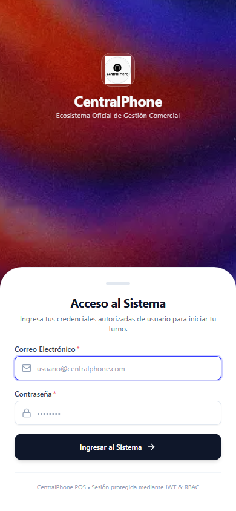

# 📱 Opción 3: Login Móvil con Bottom Sheet Inmersivo Continuo

Documento técnico y guía de replicación exacta para la implementación de la **Opción 3** de pantalla de inicio de sesión para **CentralPhone**, inspirada en el patrón de diseño nativo móvil (referencia *Farmora*).



---

## 📋 1. Descripción del Concepto Visual y UX

Esta solución aborda el desafío de **persistir la identidad visual artística corporativa** (`auth-hero-exact.webp` con seda en azul cobalto y flama) en dispositivos móviles sin sacrificar la ergonomía ni generar scroll vertical (*cero scroll*):

1. **Fondo Inmersivo 100% Viewport (`fixed inset-0`)**:
   * El arte visual oficial cubre toda la superficie física de la pantalla detrás de los elementos (`scale-105` con velo de alto contraste `bg-slate-950/25`).
2. **Zona de Marca Superior (Tercio Superior ~28vh)**:
   * Isotipo oficial en contenedor esmerilado translúcido (`bg-white/10 backdrop-blur-md border border-white/25`).
   * Nombre de la empresa en blanco hueso `#F8FAFC` con texto secundario `#F1F5F9/85`.
3. **Bottom Sheet Nativo que emerge desde el borde inferior**:
   * Nace en la base de la pantalla (`bottom: 0`, `w-full`, `rounded-t-[36px]`, `rounded-b-none`, `shadow-[0_-16px_40px_rgba(0,0,0,0.22)]`).
   * Incluye tirador táctil (*pull handle*) característico de hojas modales móviles.
   * Ubica los campos de correo, contraseña y el botón principal en la zona de fácil alcance para el pulgar.
4. **Comportamiento Dual Móvil / Desktop (`lg`)**:
   * En dispositivos móviles (`< lg`): Funciona como fondo continuo + Bottom Sheet inferior.
   * En PC y tablets (`≥ lg`): Se transforma automáticamente en el diseño corporativo de tarjeta centrada de 2 columnas con split 50/50.

---

## 🔍 2. Causa Raíz Arquitectónica y Patrón `AppShell`

### El Problema del Layout Global en Next.js App Router
En aplicaciones empresariales, el layout raíz (`RootLayout`) suele definir un contenedor con márgenes laterales y padding inferior para la barra de navegación:
```html
<!-- Causa el problema: comprime el contenido e impide tocar los bordes -->
<main className="container mx-auto max-w-7xl px-4 sm:px-6 lg:px-8 py-4 pb-24">
  {children}
</main>
```
Si una pantalla de login se monta dentro de este `<main>`, el Bottom Sheet quedará separado 16px de los laterales (`px-4`) y 96px por encima del borde inferior (`pb-24`), perdiendo el efecto de hoja modal nativa.

### La Solución: Componente Desacoplador `AppShell`
Se extrae el contenedor a un componente cliente (`AppShell`) que inspecciona `usePathname()`:
* Si la ruta es `/login`: Aplica `<main className="w-full min-h-[100dvh] overflow-x-hidden">` (*full-bleed* sin padding).
* En rutas operativas (`/pos`, `/caja`, etc.): Mantiene el contenedor centrado `max-w-7xl` con `pb-24`.

---

## 🛠️ 3. Instrucciones Paso a Paso para Replicar

### Paso 1: Assets Requeridos
Asegúrate de contar con los siguientes archivos estáticos en la carpeta `public/`:
* `public/images/auth-hero-exact.webp` (Arte visual de seda azul cobalto con flama).
* `public/logo.png` (Isotipo corporativo CentralPhone).

---

### Paso 2: Crear el Componente Desacoplador `AppShell`
Crea el archivo `frontend/src/components/layout/app-shell.tsx`:

```tsx
'use client';

import React from 'react';
import { usePathname } from 'next/navigation';

export function AppShell({ children }: { children: React.ReactNode }) {
  const pathname = usePathname();
  const isLoginPage = pathname === '/login';

  // En la pantalla de login, no aplicamos padding ni límites de contenedor
  // para permitir diseños full-bleed (fondo inmersivo y bottom sheets que tocan los bordes)
  if (isLoginPage) {
    return <main className="w-full min-h-[100dvh] overflow-x-hidden">{children}</main>;
  }

  // En las pantallas del sistema operativo (POS, Caja, Recepción, etc.),
  // mantenemos el contenedor centrado y el padding inferior para la barra móvil
  return (
    <main className="container mx-auto max-w-7xl px-4 sm:px-6 lg:px-8 py-4 sm:py-6 pb-24 lg:pb-8">
      {children}
    </main>
  );
}
```

---

### Paso 3: Integrar `AppShell` en el Layout Raíz
Actualiza `frontend/src/app/layout.tsx`:

```tsx
import type { Metadata } from 'next';
import './globals.css';
import { Navbar } from '@/components/layout/navbar';
import { AuthProvider } from '@/context/auth-context';
import { AppShell } from '@/components/layout/app-shell';

export const metadata: Metadata = {
  title: 'CentralPhone - Gestión Comercial & Inventario Serializado',
  description: 'Sistema empresarial de gestión comercial, inventario por IMEI y control de caja para CentralPhone.',
};

export default function RootLayout({
  children,
}: Readonly<{
  children: React.ReactNode;
}>) {
  return (
    <html lang="es">
      <body className="min-h-screen bg-background font-sans text-foreground antialiased selection:bg-[#363EFF] selection:text-white">
        <AuthProvider>
          <Navbar />
          <AppShell>{children}</AppShell>
        </AuthProvider>
      </body>
    </html>
  );
}
```

---

### Paso 4: Implementar la Pantalla de Login
Reemplaza el contenido de `frontend/src/app/login/page.tsx` con el código exacto:

```tsx
'use client';

import React, { useState } from 'react';
import Image from 'next/image';
import { Lock, Mail, ShieldAlert, ArrowRight } from 'lucide-react';
import { useAuth } from '@/context/auth-context';
import { Button } from '@/components/ui/button';
import { Input } from '@/components/ui/input';
import { Label } from '@/components/ui/label';

export default function LoginPage() {
  const { login } = useAuth();
  const [email, setEmail] = useState('');
  const [password, setPassword] = useState('');
  const [isLoading, setIsLoading] = useState(false);
  const [errorMsg, setErrorMsg] = useState<string | null>(null);

  const handleSubmit = async (e: React.FormEvent) => {
    e.preventDefault();
    if (!email.trim() || !password.trim()) {
      setErrorMsg('Por favor, ingresa tu correo y contraseña.');
      return;
    }

    setIsLoading(true);
    setErrorMsg(null);

    try {
      await login(email.trim(), password.trim());
    } catch (err: any) {
      setErrorMsg(err.message || 'Credenciales inválidas. Verifica tu correo y contraseña.');
    } finally {
      setIsLoading(false);
    }
  };

  return (
    <div className="min-h-[100dvh] lg:min-h-[calc(100vh-4rem)] w-full flex flex-col justify-between lg:justify-center lg:items-center p-0 lg:p-10 animate-in fade-in duration-300 relative overflow-x-hidden">
      {/* =========================================================================
          FONDO INMERSIVO MÓVIL (< lg): Textura líquida continua en todo el viewport
          (Idéntico a la referencia login_ref.png)
          ========================================================================= */}
      <div className="fixed inset-0 lg:hidden pointer-events-none -z-10">
        <Image
          src="/images/auth-hero-exact.webp"
          alt="Arte visual oficial CentralPhone"
          fill
          className="object-cover object-center scale-105"
          priority
        />
        {/* Velo sutil para contraste estético */}
        <div className="absolute inset-0 bg-slate-950/25 backdrop-blur-[0.5px]" />
      </div>

      {/* =========================================================================
          SECCIÓN SUPERIOR MÓVIL (< lg): Logo y Marca en el tercio visible del fondo
          ========================================================================= */}
      <div className="lg:hidden flex flex-col items-center justify-center pt-8 pb-4 px-4 text-center select-none flex-1 min-h-[24vh] max-h-[32vh] z-10">
        <div className="relative h-14 w-14 rounded-2xl bg-white/10 backdrop-blur-md border border-white/25 p-2 shadow-2xl flex items-center justify-center mb-2">
          <Image
            src="/logo.png"
            alt="CentralPhone Logo"
            fill
            className="object-contain p-1 drop-shadow-md"
            priority
          />
        </div>
        <h1 className="text-2xl font-bold tracking-tight text-[#F8FAFC] drop-shadow-md leading-tight">
          CentralPhone
        </h1>
        <p className="text-[11px] text-[#F1F5F9]/85 font-normal tracking-wide mt-0.5">
          Ecosistema Oficial de Gestión Comercial
        </p>
      </div>

      {/* =========================================================================
          CONTENEDOR PRINCIPAL:
          - Móvil (< lg): Bottom Sheet que nace desde el fondo (w-full, rounded-t-[36px], rounded-b-none, mt-auto)
          - Desktop (≥ lg): Card de 2 columnas centrado con rounded-3xl
          ========================================================================= */}
      <div className="w-full lg:max-w-5xl bg-white rounded-t-[36px] sm:rounded-t-[40px] rounded-b-none lg:rounded-3xl shadow-[0_-16px_40px_rgba(0,0,0,0.22)] lg:shadow-2xl border-t border-slate-200/80 border-x-0 border-b-0 lg:border lg:border-slate-200/80 overflow-hidden flex flex-col lg:grid lg:grid-cols-2 z-20 mt-auto lg:my-auto">
        {/* PANEL IZQUIERDO DESKTOP (≥ lg): Hero Artístico Completo */}
        <div className="hidden lg:flex relative p-8 sm:p-12 lg:p-16 flex-col justify-center items-center text-center lg:min-h-[620px] bg-slate-950 text-white overflow-hidden select-none">
          <div className="absolute inset-0">
            <Image
              src="/images/auth-hero-exact.webp"
              alt="Arte visual oficial CentralPhone"
              fill
              className="object-cover object-center scale-105"
              priority
            />
            <div className="absolute inset-0 bg-slate-950/25 backdrop-blur-[1px]" />
          </div>

          <div className="relative z-10 flex flex-col items-center justify-center space-y-4 max-w-xs sm:max-w-sm">
            <div className="relative h-16 w-16 rounded-2xl bg-white/10 backdrop-blur-md border border-white/20 p-2.5 shadow-2xl flex items-center justify-center">
              <Image
                src="/logo.png"
                alt="CentralPhone Logo"
                fill
                className="object-contain p-1.5 drop-shadow-md"
                priority
              />
            </div>

            <p className="text-3xl sm:text-4xl font-bold tracking-tight text-[#F8FAFC] drop-shadow-md">
              CentralPhone
            </p>
            <p className="text-xs sm:text-sm text-[#F1F5F9]/80 font-normal tracking-wide">
              Ecosistema Oficial de Gestión Comercial
            </p>
          </div>
        </div>

        {/* PANEL DEL FORMULARIO: Bottom Sheet Móvil / Panel Derecho Desktop */}
        <div className="p-6 sm:p-8 lg:p-14 pb-8 sm:pb-10 lg:pb-14 flex flex-col justify-between bg-white w-full">
          {/* Tirador Táctil (Pull Handle) característico de Bottom Sheet móvil */}
          <div className="w-10 h-1 bg-slate-200 rounded-full mx-auto mb-4 lg:hidden" />

          <div className="space-y-4 my-auto">
            {/* Título de la Sección Centrado en Móvil */}
            <div className="space-y-1 text-center lg:text-left">
              <h2 className="text-xl sm:text-2xl font-bold tracking-tight text-slate-900">
                Acceso al Sistema
              </h2>
              <p className="text-xs text-slate-500">
                Ingresa tus credenciales autorizadas de usuario para iniciar tu turno.
              </p>
            </div>

            {/* Alerta de Error de Credenciales */}
            {errorMsg && (
              <div className="rounded-xl border border-rose-200 bg-rose-50/90 p-3 text-xs text-rose-700 flex items-start gap-2 shadow-sm animate-in fade-in">
                <ShieldAlert className="h-4 w-4 text-rose-600 flex-shrink-0 mt-0.5" />
                <span className="leading-relaxed">{errorMsg}</span>
              </div>
            )}

            {/* Formulario de Login Estándar y Seguro */}
            <form onSubmit={handleSubmit} className="space-y-3.5 pt-0.5">
              <div>
                <Label required>Correo Electrónico</Label>
                <div className="relative mt-1">
                  <Mail className="absolute left-3 top-3 h-4 w-4 text-slate-400" />
                  <Input
                    type="email"
                    placeholder="usuario@centralphone.com"
                    value={email}
                    onChange={(e) => setEmail(e.target.value)}
                    required
                    autoFocus
                    className="pl-9 text-xs"
                  />
                </div>
              </div>

              <div>
                <Label required>Contraseña</Label>
                <div className="relative mt-1">
                  <Lock className="absolute left-3 top-3 h-4 w-4 text-slate-400" />
                  <Input
                    type="password"
                    placeholder="••••••••"
                    value={password}
                    onChange={(e) => setPassword(e.target.value)}
                    required
                    className="pl-9 text-xs"
                  />
                </div>
              </div>

              <Button
                type="submit"
                className="w-full text-xs font-semibold h-11 mt-1 bg-slate-900 hover:bg-slate-800 rounded-xl shadow-md text-white transition-all"
                isLoading={isLoading}
                loadingText="Verificando credenciales..."
              >
                <span>Ingresar al Sistema</span>
                <ArrowRight className="ml-2 h-4 w-4" />
              </Button>
            </form>
          </div>

          {/* Footer de Seguridad y Cierre */}
          <div className="pt-4 border-t border-slate-100 mt-5">
            <p className="text-center text-[10px] text-slate-400">
              CentralPhone POS • Sesión protegida mediante JWT & RBAC
            </p>
          </div>
        </div>
      </div>
    </div>
  );
}
```

---

## 📐 4. Métricas de Pantalla y Verificación

En una prueba automatizada con Playwright en viewport estándar (iPhone 14/15, 390 × 844 px):
* **Ancho exacto del Bottom Sheet**: `390px` (`w-full`, `x: 0`).
* **Anclaje inferior**: `y: 441px, height: 403px ➔ y + height = 844px` (contacto directo con el marco inferior sin huecos).
* **Scroll vertical**: **0 px** (la totalidad de la pantalla es visible en un viewport móvil estándar de 667px o superior).
